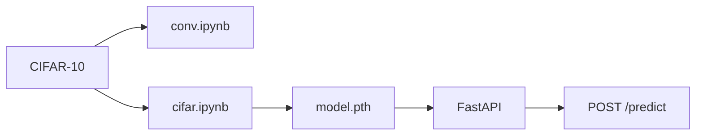

[English](README.md) | [Русский](README.ru.md)

# CIFAR-10 Image Classification


CIFAR-10 classification: three CNN implementations, from a convolution written in NumPy to a small PyTorch network and a fine-tuned ResNet-18, plus an HTTP API that serves the saved ResNet.

## About

The project assigns one of 10 classes to a 32×32 RGB image: airplane, automobile, bird, cat, deer, dog, frog, horse, ship, truck.

The dataset is CIFAR-10: **50,000** training images and **10,000** test images. The notebooks pull it from Kaggle ([`pankrzysiu/cifar10-python`](https://www.kaggle.com/datasets/pankrzysiu/cifar10-python)) and place the batches in `data/cifar-10-batches-py`. The torchvision archive in this environment was incomplete, so the download goes through `kagglehub`.

The point of the repo is the comparison. The same 10-way task is trained three ways: a Conv2d written as Python loops, a small PyTorch CNN, and a ResNet-18 adapted to 32×32. ResNet-18 is the model in the API because it demonstrates transfer learning: ImageNet weights, with `conv1`, `bn1`, `layer4`, and `fc` fine-tuned and the rest of the network frozen.

The runs live in [`notebook/conv.ipynb`](notebook/conv.ipynb) (NumPy) and [`notebook/cifar.ipynb`](notebook/cifar.ipynb) (SimpleCNN and ResNet-18). [`notebook/train.ipynb`](notebook/train.ipynb) is an earlier two-layer net on `make_moons` and is not part of this project.

## Results

PyTorch numbers are accuracy on the official CIFAR-10 test split. The notebooks print it as `val_acc`, and that label is optimistic: the loader is the test set, and the same split is scored every epoch, so the figure is test accuracy seen during training, not a held-out validation score. The NumPy run never computed test accuracy.

| Model | Train data | Epochs | Final metric |
| --- | ---: | ---: | --- |
| NumPy CNN | 500 images | 10 | train loss **0.8769** |
| SimpleCNN | 50,000 | 100 | test accuracy **85.65%** |
| **ResNet-18** (in the service) | 50,000 | 30 | test accuracy **84.27%** |

SimpleCNN, epoch 99: train loss 0.2842, test loss 0.4113, accuracy 0.8565. The best epoch was 93, at **85.80%**.

ResNet-18, epoch 29: train loss 0.4678, test loss 0.4627, accuracy 0.8427. That epoch is also the best of the 30.

NumPy, epoch 9: train loss 0.8769 on the 500-image subset.

The API serves ResNet-18, the weights in `model/model.pth`, as the transfer-learning demonstration. SimpleCNN is ahead on this split (85.65% against 84.27%) and its weights were not saved. The ResNet number is 30 epochs of partial fine-tuning from ImageNet. The SimpleCNN number is 100 epochs from scratch.

## Why the NumPy CNN is slow

`Conv2D` in [`notebook/conv.ipynb`](notebook/conv.ipynb) calls `out_count` once per image. `out_count` is a Python loop over output channels and over every spatial position. Each position slices a window and runs `.sum()`.

```python
for c in range(c_out):
    for i in range(i_size):
        for j in range(j_size):
            out_sum[c, i, j] = (
                tensor[:, i*stride:kh+i*stride, j*stride:kw+j*stride] * kernel[c]
            ).sum()
```

A normal training conv does not work like that.

- **im2col.** The fast path unfolds every window into rows of one matrix and multiplies that matrix by the kernels. One GEMM replaces the loops. This code never builds that matrix. Each window is a separate trip through the interpreter.
- **BLAS.** OpenBLAS and Accelerate speed up large matrix multiplies. A 3×3 window reduced with `.sum()` never becomes that multiply, so those libraries sit idle during the convolution. The only real matmul in this network is the last `Linear` layer (`X @ W`).
- **Backward.** `grad_kernel` is four nested Python loops, over output channels, input channels, and both kernel axes. `grad_input` calls `out_count` again for every input/output channel pair. The backward pass costs more than the forward pass.
- **GPU.** The loops stay on CPU. They cannot move to MPS or CUDA. In `cifar.ipynb` the ResNet run uses MPS. SimpleCNN never calls `.to(device)`, so it stayed on CPU, and PyTorch still trained all 50,000 images for 100 epochs, because its convolution is a vectorized kernel rather than a Python loop.

The NumPy net was cut to 500 images, batch 32, and 10 epochs because a full CIFAR pass in these loops is not practical. The loss 0.8769 is the training loss of that small run. It is not an accuracy to rank next to 85.65% and 84.27%.

The three networks also differ in size and recipe:

- **NumPy CNN.** Conv 3→8, ReLU, MaxPool, Conv 8→16, ReLU, MaxPool, Linear 1024→10. No BatchNorm, no augmentation. SGD, learning rate 0.05.
- **SimpleCNN.** Three blocks (32, 64, 128), each Conv 3×3, BatchNorm, ReLU, MaxPool, then Linear 2048→512→10. Random crop with padding 4, horizontal flip, CIFAR mean `(0.4914, 0.4822, 0.4465)` and std `(0.2470, 0.2435, 0.2616)`. SGD, learning rate 0.01, weight decay `1e-4`, cosine schedule, batch 64.
- **ResNet-18.** `torchvision` ResNet-18 with ImageNet weights. The stem is changed for 32×32: `conv1` is 3×3 with stride 1, and `maxpool` is `Identity`. `fc` is `Linear(512, 10)`. Trained parameters: `conv1`, `bn1`, `layer4`, `fc`. The rest stays frozen. ImageNet mean and std, the same crop and flip, SGD with momentum 0.9, cosine schedule, 30 epochs, batch 64, on MPS. `app/model_loader.py` rebuilds this layout before it loads `model.pth`.

## Architecture

```text
Kaggle CIFAR-10
    → notebook/conv.ipynb      NumPy CNN on 500 images
    → notebook/cifar.ipynb     SimpleCNN and ResNet-18
    → model/model.pth          ResNet-18 weights, Git LFS
    → FastAPI /predict         class name and confidence
```



## Stack

- **Python** 3.12, NumPy
- **PyTorch / torchvision** — SimpleCNN, ResNet-18, CIFAR-10 loader
- **kagglehub** — dataset download in the notebook
- **FastAPI + uvicorn + pydantic + python-multipart** — HTTP API and image upload
- **Pillow** — JPEG and PNG decoding
- **Git LFS** — `model/model.pth` (about 43 MB)
- **Docker** — `python:3.12-slim`, CPU PyTorch wheels. The image copies the checkpoint and serves it. It does not train.

## Project layout

```text
CV_train_DL/
├── app/                  FastAPI service
│   ├── main.py           /health, /predict
│   ├── schemas.py        pydantic response schema
│   └── model_loader.py   build ResNet-18 and load model.pth
├── notebook/
│   ├── conv.ipynb        NumPy CNN
│   ├── cifar.ipynb       SimpleCNN and ResNet-18
│   └── train.ipynb       not part of this project (earlier MLP on make_moons)
├── model/
│   └── model.pth         ResNet-18 weights (Git LFS)
├── data/                 CIFAR-10 batches (not in git)
├── Dockerfile
├── .dockerignore
├── requirements.txt
├── LICENSE
├── README.md
└── README.ru.md
```

`data/` is gitignored. `model.pth` is stored with Git LFS, so a clone without LFS only gets a pointer file.

## How to run

### Locally

Python 3.12. The weights come with the repository through Git LFS.

```bash
git lfs install
git lfs pull

python -m venv .venv
source .venv/bin/activate
pip install -r requirements.txt

python -m app.main           # API at http://127.0.0.1:8000
```

Without activating the venv:

```bash
.venv/bin/python -m app.main
```

Swagger UI: [http://127.0.0.1:8000/docs](http://127.0.0.1:8000/docs)

Training stays in the notebooks. Open `notebook/cifar.ipynb` to repeat SimpleCNN or ResNet-18. The first cell downloads CIFAR-10 into `data/`. There is no `src/train` module.

### Docker

The build installs CPU PyTorch, copies `app/` and `model/model.pth`, and starts uvicorn. It does not download the dataset and does not train. `model.pth` has to be the real LFS file on disk before `docker build` (`git lfs pull`).

```bash
docker build -t cv-train-dl .
docker run --rm -p 8000:8000 cv-train-dl
```

API: [http://127.0.0.1:8000](http://127.0.0.1:8000), Swagger: [http://127.0.0.1:8000/docs](http://127.0.0.1:8000/docs).

Check: `GET /health` → `{"status":"healthy"}`.

## API

- `GET /health` — the service is up and the ResNet is loaded
- `POST /predict` — class name and the model's confidence
- Interactive schema: `/docs` (Swagger)

The body is multipart, field name `file`. JPEG or PNG, up to 5 MB. The image is converted to RGB, resized to 32×32, and normalized with ImageNet mean and std, the same stats the served ResNet was trained with.

Example request:

```bash
curl -X POST http://127.0.0.1:8000/predict \
  -F "file=@image.png"
```

Example response:

```json
{
  "predicted_class": "cat",
  "confidence": 0.91
}
```

`predicted_class` is one of `airplane`, `automobile`, `bird`, `cat`, `deer`, `dog`, `frog`, `horse`, `ship`, `truck`. `confidence` is the softmax probability of that class.

## What to improve

- Rewrite the NumPy conv as im2col plus one GEMM, so BLAS actually does the work, then measure accuracy on the full test set
- A validation split that is separate from the official test set. Both PyTorch runs scored the test split every epoch
- Train SimpleCNN and ResNet-18 on the same device, with the same normalization, and save both checkpoints
- Unfreeze more of ResNet-18 if the goal is to pass SimpleCNN's 85.65%
- Tests for `/health`, the file-type check, and the 5 MB limit
- docker-compose, so the `docker run` flags do not have to be remembered

## License

[MIT](LICENSE) © 2026 Ilya Ryabets.

## Author

**Ilya Ryabets** — [GitHub](https://github.com/ng0q) · [Email](mailto:ilyaryabes71@gmail.com)

SibSUTIS student, Software Development for Automated Systems.
