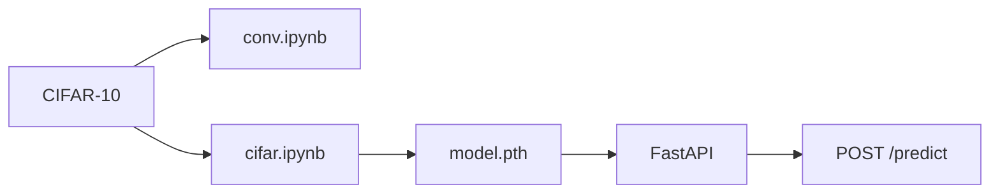

[English](README.md) | [Русский](README.ru.md)

# Классификация CIFAR-10


Классификация CIFAR-10: три реализации CNN, от свёртки на чистом NumPy до небольшой сети на PyTorch и дообученного ResNet-18, и HTTP API, который отдаёт сохранённый ResNet.

## О проекте

Проект назначает 32×32 RGB-картинке один из 10 классов: airplane, automobile, bird, cat, deer, dog, frog, horse, ship, truck.

Датасет — CIFAR-10: **50 000** обучающих изображений и **10 000** тестовых. Ноутбуки качают его с Kaggle ([`pankrzysiu/cifar10-python`](https://www.kaggle.com/datasets/pankrzysiu/cifar10-python)) и кладут батчи в `data/cifar-10-batches-py`. Архив torchvision в этом окружении был битый, поэтому загрузка идёт через `kagglehub`.

Смысл репозитория — сравнение. Одна и та же задача на 10 классов обучена тремя способами: Conv2d из питоновских циклов, небольшая CNN на PyTorch и ResNet-18, подогнанный под 32×32. Сохранён именно ResNet-18, и его грузит API.

Прогоны лежат в [`notebook/conv.ipynb`](notebook/conv.ipynb) (NumPy) и [`notebook/cifar.ipynb`](notebook/cifar.ipynb) (SimpleCNN и ResNet-18). [`notebook/train.ipynb`](notebook/train.ipynb) — ранняя двухслойная сеть на `make_moons`. К сравнению на CIFAR она не относится.

## Результаты

Цифры PyTorch — точность на официальном тестовом сплите CIFAR-10. В ноутбуках она печатается как `val_acc`, и этот сплит считается каждую эпоху, то есть по нему же смотрели обучение. Прогон на NumPy тестовую точность не считал.

| Модель | Обучающие данные | Эпохи | Итоговая метрика |
| --- | ---: | ---: | --- |
| NumPy CNN | 500 изображений | 10 | train loss **0.8769** |
| SimpleCNN | 50 000 | 100 | test accuracy **85.65%** |
| **ResNet-18** (в сервисе) | 50 000 | 30 | test accuracy **84.27%** |

SimpleCNN, эпоха 99: train loss 0.2842, test loss 0.4113, accuracy 0.8565. Лучшая эпоха — 93, **85.80%**.

ResNet-18, эпоха 29: train loss 0.4678, test loss 0.4627, accuracy 0.8427. Эта эпоха заодно лучшая из 30.

NumPy, эпоха 9: train loss 0.8769 на подвыборке из 500 изображений.

API отдаёт ResNet-18, веса из `model/model.pth`. SimpleCNN на этом сплите выше (85.65% против 84.27%), её веса не сохранялись. Цифра ResNet — это 30 эпох частичного дообучения. Цифра SimpleCNN — 100 эпох с нуля.

## Почему NumPy-CNN медленная

`Conv2D` в [`notebook/conv.ipynb`](notebook/conv.ipynb) вызывает `out_count` отдельно на каждую картинку. `out_count` — это цикл на Python по выходным каналам и по каждой пространственной позиции. На каждой позиции вырезается окно и считается `.sum()`.

```python
for c in range(c_out):
    for i in range(i_size):
        for j in range(j_size):
            out_sum[c, i, j] = (
                tensor[:, i*stride:kh+i*stride, j*stride:kw+j*stride] * kernel[c]
            ).sum()
```

Обычная свёртка при обучении устроена иначе.

- **im2col.** Быстрый путь раскладывает каждое окно в строки одной матрицы и умножает её на ядра. Один GEMM заменяет циклы. Этот код такую матрицу не строит. Каждое окно — отдельный заход в интерпретатор.
- **BLAS.** OpenBLAS и Accelerate ускоряют большие матричные умножения. Окно 3×3, свёрнутое через `.sum()`, таким умножением не становится, и на свёртке эти библиотеки простаивают. Единственный настоящий matmul в сети — последний слой `Linear` (`X @ W`).
- **Backward.** `grad_kernel` — четыре вложенных цикла на Python: выходные каналы, входные каналы и обе оси ядра. `grad_input` снова вызывает `out_count` для каждой пары входного и выходного канала. Backward дороже forward.
- **GPU.** Циклы остаются на CPU. На MPS или CUDA их не перенести. В `cifar.ipynb` прогон ResNet идёт на MPS. SimpleCNN нигде не вызывает `.to(device)`, поэтому осталась на CPU, и PyTorch всё равно прогнал все 50 000 изображений за 100 эпох: его свёртка — векторизованное ядро, а не цикл на Python.

Сеть на NumPy обрезана до 500 изображений, батча 32 и 10 эпох, потому что полный проход CIFAR в этих циклах непрактичен. Loss 0.8769 — это train loss того маленького прогона. Это не точность, которую можно поставить в один ряд с 85.65% и 84.27%.

Сети отличаются и размером, и рецептом:

- **NumPy CNN.** Conv 3→8, ReLU, MaxPool, Conv 8→16, ReLU, MaxPool, Linear 1024→10. Без BatchNorm и без аугментаций. SGD, learning rate 0.05.
- **SimpleCNN.** Три блока (32, 64, 128): Conv 3×3, BatchNorm, ReLU, MaxPool, затем Linear 2048→512→10. Random crop с padding 4, горизонтальный flip, среднее CIFAR `(0.4914, 0.4822, 0.4465)` и std `(0.2470, 0.2435, 0.2616)`. SGD, learning rate 0.01, weight decay `1e-4`, косинусное расписание, батч 64.
- **ResNet-18.** `torchvision` ResNet-18 с весами ImageNet. Стебель заменён под 32×32: `conv1` — 3×3 со stride 1, `maxpool` — `Identity`. `fc` — `Linear(512, 10)`. Обучаются `conv1`, `bn1`, `layer4`, `fc`. Остальное заморожено. Среднее и std ImageNet, те же crop и flip, SGD с momentum 0.9, косинусное расписание, 30 эпох, батч 64, устройство MPS. `app/model_loader.py` собирает эту же схему перед загрузкой `model.pth`.

## Архитектура

```text
Kaggle CIFAR-10
    → notebook/conv.ipynb      NumPy CNN на 500 изображениях
    → notebook/cifar.ipynb     SimpleCNN и ResNet-18
    → model/model.pth          веса ResNet-18, Git LFS
    → FastAPI /predict         имя класса и уверенность
```



## Стек

- **Python** 3.12, NumPy
- **PyTorch / torchvision** — SimpleCNN, ResNet-18, загрузчик CIFAR-10
- **kagglehub** — скачивание датасета в ноутбуке
- **FastAPI + uvicorn + pydantic + python-multipart** — HTTP API и загрузка картинки
- **Pillow** — разбор JPEG и PNG
- **Git LFS** — `model/model.pth` (около 43 МБ)
- **Docker** — `python:3.12-slim`, CPU-колёса PyTorch. Образ копирует чекпоинт и отдаёт его. Обучение внутрь сборки не входит.

## Структура проекта

```text
CV_train_DL/
├── app/                  FastAPI-сервис
│   ├── main.py           /health, /predict
│   ├── schemas.py        pydantic-схема ответа
│   └── model_loader.py   сборка ResNet-18 и загрузка model.pth
├── notebook/
│   ├── conv.ipynb        NumPy CNN
│   ├── cifar.ipynb       SimpleCNN и ResNet-18
│   └── train.ipynb       ранняя MLP на make_moons
├── model/
│   └── model.pth         веса ResNet-18 (Git LFS)
├── data/                 батчи CIFAR-10 (не в git)
├── Dockerfile
├── .dockerignore
├── requirements.txt
├── README.md
└── README.ru.md
```

`data/` в gitignore. `model.pth` лежит в Git LFS: клон без LFS получает только файл-указатель.

## Как запустить

### Локально

Нужен Python 3.12. Веса приезжают вместе с репозиторием через Git LFS.

```bash
git lfs install
git lfs pull

python -m venv .venv
source .venv/bin/activate
pip install -r requirements.txt

python -m app.main           # API на http://127.0.0.1:8000
```

Без активации venv:

```bash
.venv/bin/python -m app.main
```

Swagger UI: [http://127.0.0.1:8000/docs](http://127.0.0.1:8000/docs)

Обучение остаётся в ноутбуках. SimpleCNN и ResNet-18 повторяются из `notebook/cifar.ipynb`. Первая ячейка скачивает CIFAR-10 в `data/`. Модуля `src/train` в репозитории нет.

### Docker

Сборка ставит CPU PyTorch, копирует `app/` и `model/model.pth` и запускает uvicorn. Датасет не скачивается, обучение не запускается. Перед `docker build` на диске должен лежать настоящий файл LFS, а не указатель (`git lfs pull`).

```bash
docker build -t cv-train-dl .
docker run --rm -p 8000:8000 cv-train-dl
```

API: [http://127.0.0.1:8000](http://127.0.0.1:8000), Swagger: [http://127.0.0.1:8000/docs](http://127.0.0.1:8000/docs).

Проверка: `GET /health` → `{"status":"healthy"}`.

## API

- `GET /health` — сервис жив и ResNet загружен
- `POST /predict` — имя класса и уверенность модели
- Интерактивная схема: `/docs` (Swagger)

Тело запроса — multipart, поле `file`. JPEG или PNG, до 5 МБ. Картинка переводится в RGB, ресайзится до 32×32 и нормализуется средним и std ImageNet — теми же, на которых учился отдаваемый ResNet.

Пример запроса:

```bash
curl -X POST http://127.0.0.1:8000/predict \
  -F "file=@image.png"
```

Пример ответа:

```json
{
  "predicted_class": "cat",
  "confidence": 0.91
}
```

`predicted_class` — одно из `airplane`, `automobile`, `bird`, `cat`, `deer`, `dog`, `frog`, `horse`, `ship`, `truck`. `confidence` — softmax-вероятность этого класса.

## Что можно улучшить

- Переписать свёртку на NumPy через im2col и один GEMM, чтобы работу делал BLAS, и после этого померить точность на полном тесте
- Отдельный validation split, не официальный тест. Оба прогона на PyTorch считали тестовый сплит каждую эпоху
- Обучить SimpleCNN и ResNet-18 на одном устройстве и с одной нормализацией и сохранить оба чекпоинта
- Разморозить больше слоёв ResNet-18, если цель — обойти 85.65% у SimpleCNN
- Тесты на `/health`, проверку типа файла и лимит 5 МБ
- docker-compose, чтобы не помнить флаги `docker run`
- Ошибка загрузчика до сих пор советует `python -m src.train`. Такого модуля нет. Веса — это `model/model.pth`

## Автор

**Илья Рябец** — [GitHub](https://github.com/ng0q) · [Email](mailto:ilyaryabes71@gmail.com)

Студент СибГУТИ, специальность «Разработка ПО для автоматизированных систем».
